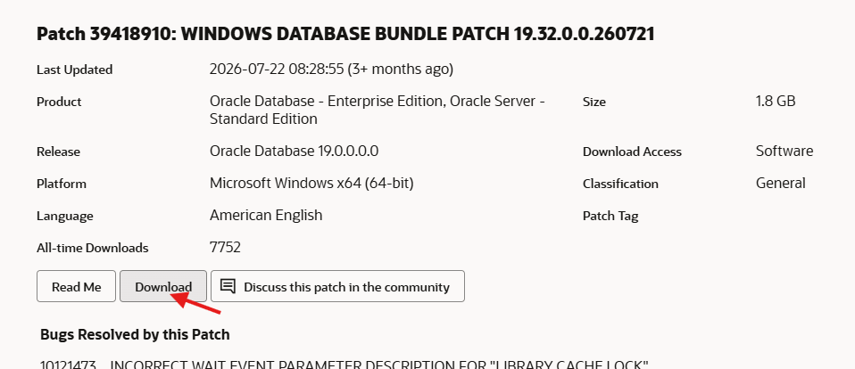
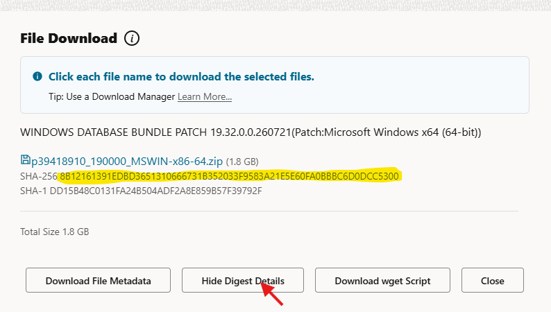

# Get-MosPatch

PowerShell-Skript zum Herunterladen von Oracle-Patches aus My Oracle Support (MOS) auf Rechnern ohne Browser, z. B. Windows-Server, auf die man nur per RDP zugreift.

Das Skript arbeitet eine Liste von Download-URLs ab, authentifiziert sich per Access-Token (`Authorization: Bearer ...`, wie das von MOS erzeugte `wget.sh`) und prueft jede Datei nach dem Download per SHA-256 und ZIP-Test.

> Inoffizielles Hilfsprogramm, nicht von Oracle. Die Authentifizierung entspricht dem Verhalten des von MOS erzeugten `wget.sh`; Oracle kann das Verfahren jederzeit aendern.

## Voraussetzungen

- Windows PowerShell 5.1 oder PowerShell 7
- `curl.exe` ab Version 7.55 (in Windows 10 ab 1803 und Windows Server 2019 enthalten)
- Netzwerkzugriff (HTTPS/443) auf `updates.oracle.com` und die von dort weiterleitenden Download-Hosts (u. a. `aru-akam.oracle.com`), also keine Proxy-/Firewall-Sperre
- Ein My-Oracle-Support-Konto mit Download-Berechtigung

## Dateien vorbereiten

Lege alle Dateien in **einen Ordner**, z. B. `D:\Patches`:

```text
D:\Patches\
  urls.txt            # URL-Datei (Name frei waehlbar)
  access_token.txt    # Access-Token
```

Die Zip-Dateien werden ebenfalls in diesem Ordner abgelegt.

### 1. URL-Zeilen erstellen

Jede Zeile der URL-Datei hat das Format

```text
URL,PATCH_PASSWORD,SHA256
```

Das Patch-Passwort ist meist leer, die beiden Kommas bleiben trotzdem stehen (`URL,,SHA256`). Die SHA-256-Pruefsumme ist **nicht Teil der URL**, sie steht hinter dem ersten Komma-Block. Leerzeilen und Zeilen mit `#` werden ignoriert, mehrere Patches = mehrere Zeilen.

#### Variante A: aus dem Download-Dialog (schnell)

1. In MOS den Patch oeffnen (Patches & Updates) und **Download** waehlen. 

   

2. Es oeffnet sich der Dialog *File Download* mit dem Dateinamen als Link.

   

2. Rechtsklick auf den Dateinamen und **Link-Adresse kopieren** (nicht anklicken). Das ist der URL-Teil, er enthaelt den Dateinamen zweimal (Pfad und `patch_file=`) sowie den patchspezifischen Parameter `aru`.

3. Im selben  Dialog auf den Button **View Digest Details** klicken und den daraufhin eingeblendeten **SHA-256**-Wert kopieren (nicht MD5/SHA-1).

4. In die URL-Datei einfuegen: URL, dann `,,`, dann der SHA-256-Wert, alles in einer Zeile ohne Leerzeichen:

   ```text
   <URL>,,<SHA256>
   ```

#### Variante B: aus dem wget.sh

1. Im Download-Dialog **Download wget Script** waehlen.
2. Im heruntergeladenen `wget.sh` steht zwischen `#start of patch list` und `#END of patch list` die fertige Zeile im Format `URL,PATCH_PASSWORD,SHA256`.
3. Diese Zeile unveraendert in die URL-Datei kopieren.

Variante B ist die Referenz, wenn etwas nicht passt (z. B. bei Patches mit Passwort), weil die Zeile von MOS selbst erzeugt wird. Variante A ist meist schneller, da das ueber 350 Zeilen lange Skript nicht durchsucht werden muss.

Beispiel (`urls.txt`):

```text
# 19.32 Windows
https://updates.oracle.com/Orion/Services/download/p39418910_190000_MSWIN-x86-64.zip?aru=28808361&patch_file=p39418910_190000_MSWIN-x86-64.zip,,8b12161391edbd3651310666731b352033f9583a21e5e60fa0bbbc6d0dcc5300
```

### 2. Access-Token holen

1. Im Browser bei My Oracle Support anmelden.
2. In derselben Sitzung diese URL aufrufen:

   ```text
   https://updates.oracle.com/Orion/GenToken/get_token
   ```

3. Das angezeigte Token als **eine Zeile** in `access_token.txt` einfuegen. Leerzeilen und Zeilen mit `#` werden ignoriert.

Das Token ist nur etwa **1 Stunde gueltig**. Bei grossen Downloads oder mehreren Patches lieber kurz vor dem Start holen.

## Aufruf

```powershell
.\Get-MosPatch.ps1 D:\Patches\urls.txt
```

Der Pfad der URL-Datei bestimmt die Arbeitsverzeichnisse:

| Was | Standard | Aenderbar mit |
|---|---|---|
| Tokendatei | `access_token.txt` im Ordner der URL-Datei | `-TokenFile <Pfad>` |
| Zielordner der Downloads | Ordner der URL-Datei | `-OutDir <Pfad>` |

Beispiel mit abweichenden Pfaden:

```powershell
.\Get-MosPatch.ps1 .\urls.txt -TokenFile C:\secure\access_token.txt -OutDir E:\Downloads
```

## Was das Skript macht

1. Liest Token und URL-Liste.
2. Fuer jede Zeile: Dateiname aus `patch_file` ermitteln und pruefen, SHA-256 verlangen, optionales Patch-Passwort als `patch_password` anhaengen.
3. Ist die Zieldatei schon vorhanden und der Hash stimmt, wird sie uebersprungen.
4. Sonst Download mit `curl.exe` (mit Wiederaufnahme `-C -`, Wiederholungen und Header `Authorization: Bearer <token>`, auch bei der Weiterleitung auf den Download-Host).
5. Nach dem Download SHA-256-Vergleich und ZIP-Pruefung.
6. Zusammenfassung am Ende.

Die Patches werden nacheinander geladen. Ein Fehler bei einer Datei stoppt die anderen nicht, ausser bei einem Authentifizierungsfehler (siehe Exitcodes).

## Exitcodes

| Code | Bedeutung |
|---|---|
| 0 | Alle Downloads erfolgreich |
| 10 | Mindestens ein Fehler (Download, Hash, ZIP) |
| 12 | Authentifizierung fehlgeschlagen (HTTP 401/403), restliche Eintraege uebersprungen |

## Fehlersuche

- **HTTP 401/403**: Token abgelaufen oder ungueltig. Neues Token holen und das Skript erneut starten; fertige Dateien werden per Hash erkannt und nicht neu geladen.
- **Download liefert eine HTML-Datei / "Sorry, company policy prohibits this action"**: Eine Firewall oder ein Web-Proxy (z. B. Zscaler) blockiert den Zugriff auf Oracle. Freigabe fuer die Oracle-Hosts beantragen.
- **SHA-256 stimmt nicht**: Download unvollstaendig oder veraendert, oder es wurde ein falscher Digest (MD5/SHA-1) eingetragen. Datei loeschen und neu laden.
- **"SHA-256 fehlt"**: Die Zeile in der URL-Datei muss das Format `URL,PASSWORT,SHA256` haben (zwei Kommas auch bei leerem Passwort, keine Leerzeichen oder Zeilenumbrueche im Hash).
- **`curl.exe` nicht gefunden**: Aeltere Windows-Versionen (z. B. Server 2016) liefern es nicht mit; curl separat bereitstellen.

## Sicherheit

- `access_token.txt` und die URL-Datei (ggf. mit Patch-Passwoertern) nicht ins Repository einchecken. Die mitgelieferte `.gitignore` schliesst typische Namen aus.
- Zugriff auf die Tokendatei einschraenken und sie nach dem Download loeschen:

  ```powershell
  icacls .\access_token.txt /inheritance:r /grant:r "${env:USERNAME}:(R,W)"
  Remove-Item .\access_token.txt
  ```

- Das Token wird nur ueber eine temporaere Header-Datei an `curl.exe` uebergeben (nicht als Kommandozeilenargument) und nach dem Lauf geloescht.
